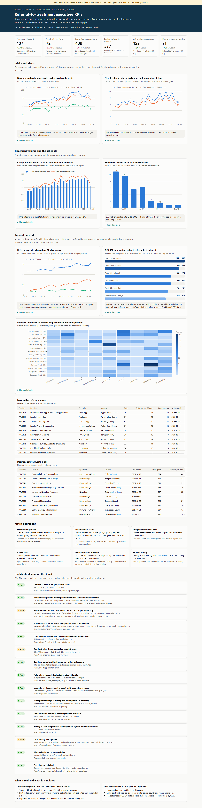
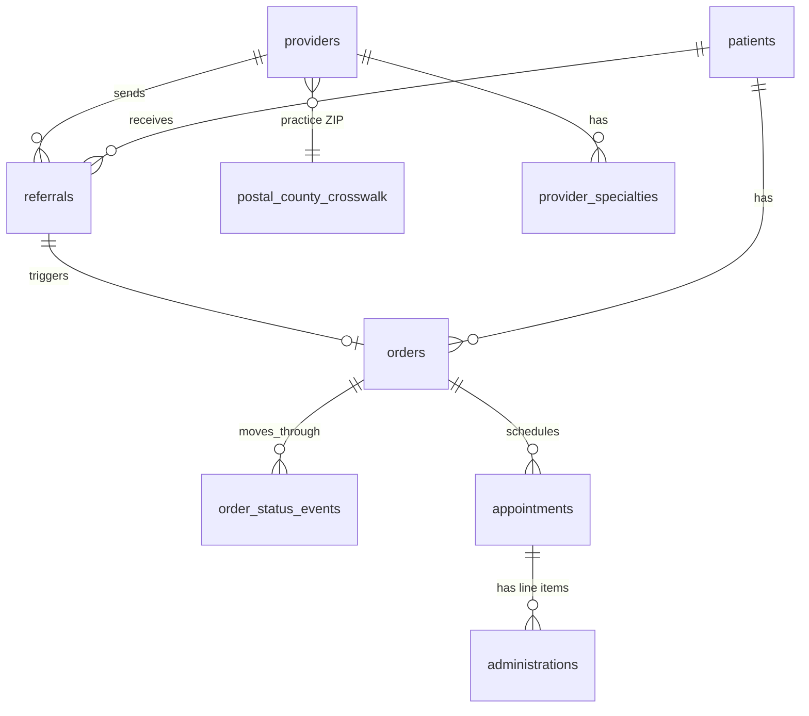

# Project A - Referral-to-treatment executive KPIs

> **SYNTHETIC DEMONSTRATION - not operational, medical or financial guidance.**
> Coralline Infusion Network is fictional. Every number here comes from generated data (seed `20261024`).
> This is a personal, independent reconstruction of skills - not a production deployment and not employer results.



**Open the interactive version:** [live page](https://delmanuelcruz-wq.github.io/healthcare-analytics-portfolio/A_executive_kpi/dashboard.html) ([`dashboard.html`](dashboard.html) source) (hover tooltips, data tables under every chart, light/dark).

---

## 1. The business question

Sales and operations leaders want one page that answers:

- How many **new patients** were referred this month?
- How many of them actually **started treatment**?
- How many **treatment visits** did we complete, and what is already **booked**?
- Which **referral sources** are active, and which have gone quiet - and where are they?

The hard part is not the charts. It is making sure each number measures what its label says.

## 2. Fictional business context

Coralline Infusion Network (fictional) runs eight infusion suites in three states. Patients arrive by referral,
go through benefits verification and prior authorization, get scheduled, and receive infusions or injections
over a series of visits. The synthetic universe covers July 2024 to a snapshot on **October 24, 2026**
(October is a partial month), with ~2,500 patients, 250 provider records and ~10,000 appointments.
See [`../foundation/MANIFEST.md`](../foundation/MANIFEST.md).

## 3. What was real vs what I built here

| | |
|---|---|
| **On-the-job exposure (described in general terms only)** | Worked with an analytics manager to turn a sales leader's asks into separate, measurable KPIs. Built and saved **two draft monthly trend reports** in Looker: patients created per month, and first treated new patients per month (first appointment + Complete + medication administered + distinct patient count), with the partial month labelled. Captured the rolling-90-day active/dormant provider definitions and the rule that geography means the *referring provider's* county. |
| **Not done on the job** | No completed production dashboard, no certified KPIs, no live automation. The completed-visit metric, provider status model, county view and forecast were next steps, not finished work. |
| **Independently built for this portfolio** | The synthetic data model, all SQL, the QA suite, tests, this dashboard, and the extensions marked below: completed treatment visits, booked pipeline, rolling-90-day provider status, county x specialty view, and the Q2 cohort funnel. |

## 4. Data model used



| Table | Grain | Key |
|---|---|---|
| `patients` | one row per synthetic patient | `patient_key` |
| `referrals` | one row per referral event (renewals and duplicate faxes included) | `referral_key` |
| `orders` | one row per order series (renewals create new series) | `order_key` |
| `appointments` | one row per appointment, as of the snapshot | `appt_key` |
| `administrations` | one row per medication line item - many per appointment allowed | `admin_key` |
| `providers` | one row per provider *record*; duplicates share `source_identity_key` | `provider_key` |

Full column-level dictionary: [`../foundation/DATA_DICTIONARY.md`](../foundation/DATA_DICTIONARY.md).

## 5. Metric dictionary

| Metric | Definition | The trap it avoids |
|---|---|---|
| New referred patients | Distinct patients with `patients.created_at` in the month | Order series (+46% higher here) count renewals and therapy changes for existing patients |
| New treatment starts | Distinct patients whose **first qualifying visit** falls in the month. Qualifying = Complete, medication administered, and at least one administration line actually given | The first-appointment flag sits on the first *booked* visit, which may have been cancelled, missed or held |
| Completed treatment visits | Distinct appointments meeting the qualifying rule | Counting line items (split lots, add-on pre-medication, duplicates) overstates volume |
| Booked visits | Distinct appointments after the snapshot with status Scheduled or Confirmed | Treating the schedule as a forecast |
| Active provider | Provider person with 1+ referral in (as-of - 90 days, as-of] | Calendar quarters are not a rolling window |
| Dormant provider | Referred at some earlier point, none in that window | Never-referred providers are not dormant |
| Provider county | County of the referring provider's practice ZIP (primary crosswalk row) | Patient home county or infusion-site county answer a different question |

Details and edge cases: [`METRIC_DICTIONARY.md`](METRIC_DICTIONARY.md).

## 6. Data files

- Inputs: `../foundation/data/*.csv` (synthetic, with checksums and a manifest).
- Outputs written by `run.py` to [`outputs/`](outputs/): `monthly_kpis.csv`, `future_bookings_weekly.csv`,
  `provider_status_monthly.csv`, `provider_status_current.csv`, `county_specialty_referrals_12m.csv`,
  `q2_2026_cohort_milestones.csv`, `q2_2026_cohort_funnel.csv`, `q2_2026_cohort_lead_times.csv`, `qa_results.csv`.

## 7. How it works (repeatable code)

| Step | File | What it does |
|---|---|---|
| Staging | [`sql/01_staging.sql`](sql/01_staging.sql) | Qualifying visits, derived first treatment, deduplicated provider people with county |
| Monthly KPIs | [`sql/02_monthly_kpis.sql`](sql/02_monthly_kpis.sql) | Correct measures and their tempting-but-wrong versions side by side |
| Pipeline | [`sql/03_future_bookings.sql`](sql/03_future_bookings.sql) | Booked visits by week after the snapshot |
| Provider status | [`sql/04_provider_status_monthly.sql`](sql/04_provider_status_monthly.sql), [`05`](sql/05_provider_status_current.sql) | Rolling-90-day status at each month end, with no future data |
| Geography | [`sql/06_county_specialty.sql`](sql/06_county_specialty.sql) | Referrals by provider county x primary specialty |
| Cohort | [`sql/07_cohort_milestones.sql`](sql/07_cohort_milestones.sql) | Patient-level milestones for the Q2 2026 cohort |
| Build | [`run.py`](run.py) | Runs the SQL, the QA suite, the funnel, CSVs, README charts and the dashboard |

```bash
python foundation/generate.py         # regenerate synthetic data (byte-identical for the same seed)
python foundation/build_warehouse.py  # load into SQLite with enforced keys
python A_executive_kpi/run.py         # build this project
python -m pytest A_executive_kpi/tests -q
```

## 8. Quality checks

- **Tests:** [`tests/test_project_a.py`](tests/test_project_a.py) - 14 assertions, including: every patient starts once;
  visits never exceed line items; planted lines on cancelled appointments never count; duplicate lines never add visits;
  provider status partitions are complete; a separate pure-Python implementation reproduces the rolling-90-day
  counts at all 22 snapshots, with no future data used.
- **QA log:** [`QA_LOG.md`](QA_LOG.md) - 15 checks run on every build (12 pass, 3 warn, 0 fail). A WARN means a real
  data issue was found and handled, such as 3 administration lines charted against cancelled visits.

## 9. The dashboard

Six KPI tiles, seven charts (each with a data table), two action lists, the definitions and the QA results.
Charts follow a colorblind-checked palette, validated with the palette script. See the screenshot above,
or open [`dashboard.html`](dashboard.html).

## 10. What the synthetic data shows

These insights describe fabricated data and exist to show the reasoning:

- **Definitions change the story.** From January 2025 to the October snapshot, order series ran **46% above** new patients. A "new business"
  chart built on order dates would overstate growth from renewals.
- **The flag shortcut misses real starts.** The first-appointment flag method found **1,692** of **1,929** patients who ever
  started (**12.3% missed**). Their first booked visit was cancelled, missed, or medication was held.
- **Line items are not visits.** 9,424 administration lines described 8,642 treated visits. 638 visits carried two or more
  lines given to the patient.
- **The schedule is a pipeline, not a forecast.** Bookings fall sharply after about three weeks. That is booking lead time,
  not falling demand.
- **The referral network is growing, and so is the quiet pool.** 153 active and 71 dormant sources on Oct 24, vs 116 and
  19 in January 2025. The dormant list is a ready-made outreach list.
- **Q2 2026 cohort:** 79% of new patients were treated by the snapshot and 76% within 60 days. Median end-to-end
  referral to first treatment was **28.9 days**. Authorization clearance (13.7 days) is the largest single step.

## 11. Limitations and next steps

- Patient creation is a *proxy* for referral intake. A real build should confirm that the business reads it that way.
- Late updates: 8 past visits had not closed by the snapshot, so recent weeks understate volume until updates land.
  Next step: daily refresh with an updated-at watermark (see the [refresh case study, workstream 19](../tier2/19_incremental_refresh/)).
- Provider geography uses fabricated ZIPs mapped to fictional counties. No real map is drawn.
- The booked-visit view is not a forecast. A forecast would need historical booking curves - a natural extension.
- Not built: profitability, sales-rep views (deliberately excluded from the original asks), or live publishing.

---

### Resume-safe language

- *On the job:* "Built and saved two draft Looker trend reports for monthly referral intake and first administered patient
  treatments, and documented rolling-90-day definitions for referral-provider activity."
- *Portfolio:* "Independently built a synthetic referral-to-treatment KPI model (SQLite, Python, Plotly) with
  event-derived first-treatment logic, rolling-90-day provider status, and a 15-check QA suite."

See [`RECRUITER_SUMMARY.md`](RECRUITER_SUMMARY.md) for a 30-second version.
