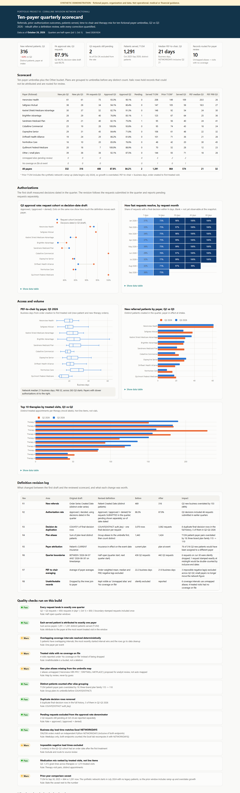
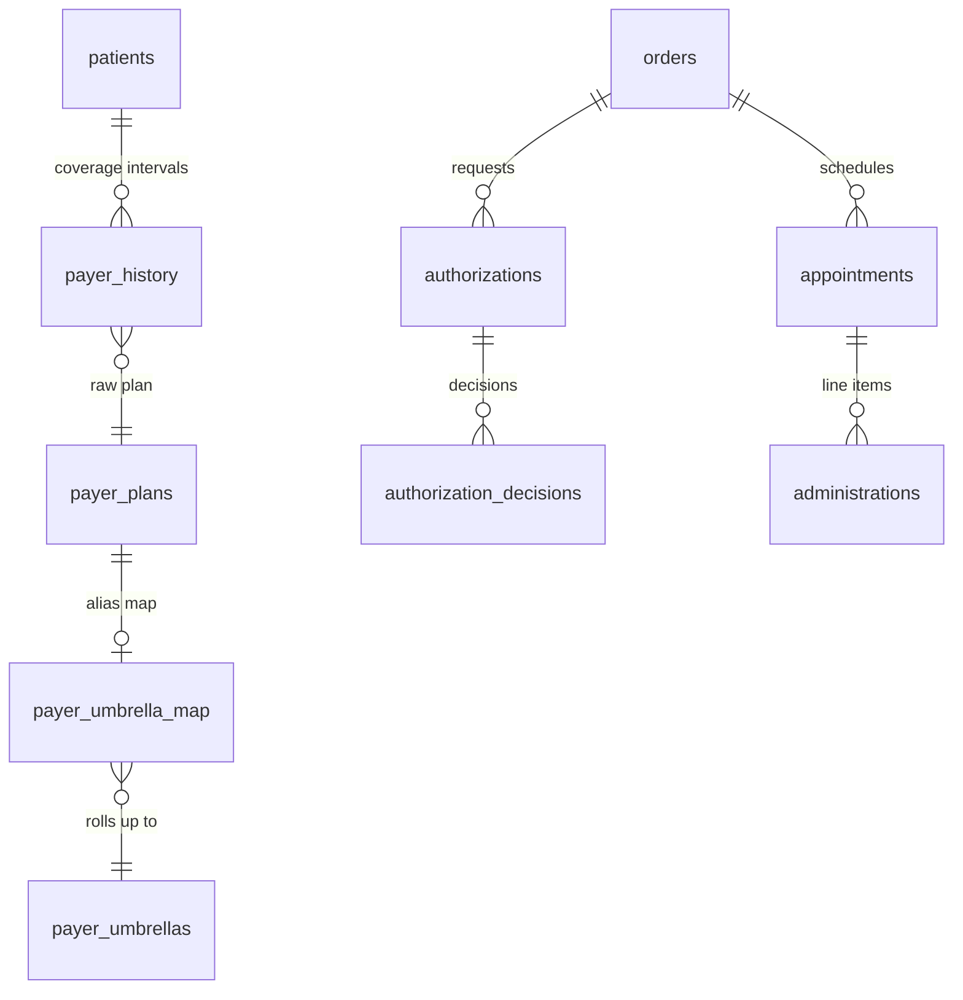

# Project B - Ten-payer quarterly scorecard

> **SYNTHETIC DEMONSTRATION - not operational, medical or financial guidance.**
> All payers, plans, patients and amounts are fictional. The ten payer names were invented and do not correspond to real insurers.
> This is a draft-style analytical reconstruction built independently - not an approved company report.



**Interactive:** [live page](https://delmanuelcruz-wq.github.io/healthcare-analytics-portfolio/B_payer_scorecard/dashboard.html) ([`dashboard.html`](dashboard.html) source) · **Workbook:** [`payer_scorecard.xlsx`](payer_scorecard.xlsx) (live formulas, revision log, QA tab)

---

## 1. The business question

Marketing and operations leaders asked: for each of our ten largest payer umbrellas, how did **Q3 2026 compare with Q2**
on new referrals, prior-authorization approvals, patients served, time from order to chair, and therapy mix?

The first draft answered quickly and got several definitions wrong. This project rebuilds it and **quantifies every correction**.

## 2. Fictional business context

Coralline Infusion Network (fictional) bills about a dozen payer umbrellas. Source systems store **raw plan names**
as typed, including aliases ("Saltgrass Mut."), a three-brand plan family, and two aliases that were never mapped.
Patients change insurance, so "which payer?" depends on *when*. Data runs to an October 24, 2026 snapshot.

## 3. What was real vs what I built here

| | |
|---|---|
| **On-the-job exposure (general terms only)** | Explored order, patient, appointment and insurance sources in Looker; built and tested distinct-patient measures and quarter filters; consolidated payer aliases and a combined plan family in Excel; assembled a working scorecard and a multi-tab audit workbook. In a manager review, learned two key corrections: new referrals should use **patient created date** rather than order-series created date, and authorization rates should follow the **request cohort**, not decisions made in the quarter. |
| **Still open on the job** | Umbrella definitions, patient-payer attribution and final approval were open QA items. Nothing here claims an approved or distributed report. |
| **Independently built for this portfolio** | The cohort-correct rebuild on synthetic data, the eight-entry revision log, the authorization maturity triangle, the Excel workbook, this dashboard, the QA suite and tests. |

## 4. Data model used



The key staging step ([`sql/01_staging.sql`](sql/01_staging.sql)) attaches the payer **in effect on the event date** to every
treated visit, patient intake and order. Overlapping intervals resolve to the most recently started one. No covering interval
gives `NO_COVERAGE`. Unmapped aliases give `UNMAPPED`. Nothing is silently dropped.

## 5. Metric definitions

| Metric | Definition |
|---|---|
| New referred patients | Distinct patients created in the quarter, attributed to the payer in effect at intake |
| PA requests (cohort) | Requests **submitted** in the quarter (half-open window), outcome as of Oct 24 |
| Approval rate | Approved / (approved + denied); pending reported separately, never as denied |
| Patients served | Distinct patients with 1+ treated visit in the window, attributed to the payer at their **most recent** treated visit there |
| PEF-to-chair | Business days from order-series creation to the order's first treated visit, inclusive of both endpoints (Excel `NETWORKDAYS`); new-patient and new-therapy orders whose first treatment fell in the quarter |
| Therapy mix | Distinct treated appointments per therapy (not line items, not vials) |

## 6. Definition revision log

Computed live by [`run.py`](run.py). Synthetic values:

| # | Area | First draft | Revised | Before → after | Impact |
|---|---|---|---|---|---|
| R1 | New referrals | Order Series Created Date | Patient Created Date | 469 → **316** | Q3 new business overstated by 48% |
| R2 | Authorization rate | Decisions dated in the quarter | Requests submitted in the quarter | 88.3% → **87.9%** | 46 Q3 decisions belonged to earlier requests; one payer moves from 80.9% to 76.9%, another from 93.3% to 86.2% |
| R3 | Decision duplicates | `COUNT(*)` of decision rows | One final decision per request | 3,070 → **3,062** | 8 duplicate rows removed |
| R4 | Plan aliases | Sum of plan-level distinct patients | Group to umbrella, then count | 1,443 → **1,424** | Three-brand plan family 115 → 110 patients |
| R5 | Payer attribution | Current insurance | Insurance on the event date | - | 76 of 316 Q3 new patients would land on the wrong payer |
| R6 | Quarter boundaries | `BETWEEN '…-04-01' AND '…-06-30'` on timestamps | Half-open `[start, next start)` | 436 → **442** Q2 requests | 6 requests on Jun 30 silently dropped; a midnight-stamped request would double-count |
| R7 | Lead-time averaging | Average of payer averages | Order-weighted mean, median, P90 | 22.2 → **21.9** days | 3 impossible negative lags excluded |
| R8 | Unattributable records | Dropped by an inner join | Visible review buckets | - | 6 intervals on unmapped aliases; 4 treated visits with no coverage |

## 7. Repeatable code

| File | Purpose |
|---|---|
| [`sql/01_staging.sql`](sql/01_staging.sql) | Plan → umbrella, payer-at-event for visits, intake and orders, half-open quarters |
| [`sql/02_new_patients.sql`](sql/02_new_patients.sql) | New patients plus the two rejected alternatives |
| [`sql/03_auth_cohort.sql`](sql/03_auth_cohort.sql) / [`04`](sql/04_auth_decision_method.sql) | Request cohort vs decision-date draft |
| [`sql/05_patients_served.sql`](sql/05_patients_served.sql) | T12M and quarterly served patients |
| [`sql/06_pef_to_chair.sql`](sql/06_pef_to_chair.sql) | Order-level business-day lead times via a calendar table |
| [`sql/07_medication_mix.sql`](sql/07_medication_mix.sql) / [`08`](sql/08_alias_audit.sql) | Therapy mix; plan-level alias audit |
| [`run.py`](run.py) | Scorecard, revision log, maturity triangle, QA, Excel workbook, dashboard |

```bash
python B_payer_scorecard/run.py
python -m pytest B_payer_scorecard/tests -q
```

## 8. Quality checks

- [`tests/test_project_b.py`](tests/test_project_b.py), 10 tests: quarters are exclusive; boundary-stamped requests count once;
  rates use resolved requests only; every served patient has exactly one payer; alias grouping never increases counts; planted coverage gaps
  surface as `NO_COVERAGE`; SQL business days equal an independent Python `NETWORKDAYS` (including reversed dates, as Excel does);
  planted negative lead times are excluded; every revision changes a number; the workbook keeps live formulas.
- [`QA_LOG.md`](QA_LOG.md) - 12 checks (7 pass, 5 warn, 0 fail). WARN rows are real issues that were bucketed, excluded or routed.

## 9. Deliverables

- **Dashboard:** six tiles, the scorecard table, approval-rate dumbbell (cohort vs draft), maturity triangle, PEF-to-chair box plots,
  Q2/Q3 referrals, top-10 therapy mix, the revision log and QA.
- **Excel workbook:** README, Scorecard (formulas for rates and changes), Auth cohort, Served, PEF-to-chair (with an Excel
  `NETWORKDAYS()` column beside the SQL value and an OK/CHECK match column), Medication mix, Alias audit, Auth maturity, Revision log, QA.

## 10. What the synthetic data shows

- The definition review mattered most for **new referrals**. Order series overstated Q3 new business by 48%.
- At network level the authorization-rate fix is small (88.3% → 87.9%). **Per payer it is not**: two payers move by 4 to 7 points. A payer
  conversation based on the draft would have started from the wrong number.
- One in four Q3 new patients (76 of 316) would be attributed to a different payer under current-insurance logic.
- Median PEF-to-chair was **21 business days** in Q3 (P90 32). Payers with slower authorization turnaround sit at the right of the box plot.
- Most requests resolve within 14-30 days, so a quarter's approval rate is stable roughly a month after quarter end.
  The maturity triangle shows exactly when that is.

## 11. Limitations and next steps

- **Prior-year comparisons overstate growth.** The synthetic network starts in July 2024 with no legacy patients, so the
  T12M-to-Sep-2025 window includes ramp-up. The caveat sits next to the number on every surface.
- Patient-payer attribution uses the most recent treated visit. Other valid rules (first visit, majority of visits) are worth a sensitivity tab.
- The two unmapped aliases are *proposed* for review, not auto-mapped.
- No reimbursement, revenue or contract terms are modeled - and none should be inferred.

---

### Resume-safe language

- *On the job:* "Developed a draft multi-metric payer performance scorecard in Looker and Excel, consolidated payer aliases, and revised
  referral and authorization cohort definitions after manager review (draft under definition review)."
- *Portfolio:* "Rebuilt a ten-payer scorecard on synthetic data with insurance-at-event attribution, request-cohort authorization rates,
  NETWORKDAYS lead times and an eight-item revision log quantifying each definition change."
