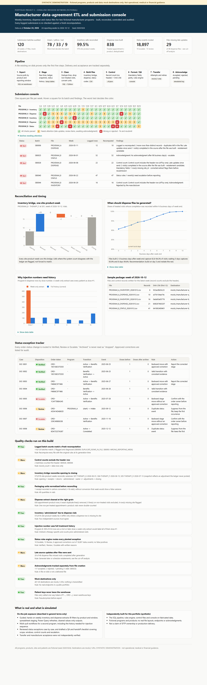

# Project C - Manufacturer data-agreement ETL and submission QA

> **SYNTHETIC DEMONSTRATION - not operational, medical or financial guidance.**
> Programs, products, sites and patients are fictional. File layouts are invented, and destinations are `mock://` URIs.
> Nothing is transmitted. This is not a claim of production delivery or SFTP ownership.



**Interactive console:** [live page](https://delmanuelcruz-wq.github.io/healthcare-analytics-portfolio/C_manufacturer_etl_qa/dashboard.html) ([`dashboard.html`](dashboard.html) source) · **Sample weekly package:** [`outputs/sample_submission/`](outputs/sample_submission/)

---

## 1. The business question

Under data agreements, an infusion provider sends manufacturers weekly files about specific products: **inventory**
(stock in and out), **dispense** (what was actually administered) and, for some programs, **treatment status**.
The files must be right, provably complete, and actually received. A file existing on disk proves none of that.

## 2. Fictional business context

Two fictional programs: **PROGRAM_A** covers one infused product (THERAPY_D). **PROGRAM_B** covers two injected products
(THERAPY_F and THERAPY_G) and adds a status file. Eight sites, 24 reporting weeks (May 4 - Oct 18, 2026), 120 logged
submissions. The submission log records what the operator *said* happened: counts, control totals, transfer attempts, acknowledgments.

## 3. What was real vs what I built here

| | |
|---|---|
| **On-the-job exposure (general terms only)** | Extensive guided, hands-on weekly inventory and dispense work: BI filters by product and reporting window, opening/closing snapshots, spreadsheet staging tables, Power Query refreshes, cleaned values-only outputs, and control-file concepts (exact file identification, record counts). For a second program: multi-pull dispense with prior visits for injection sequence, plus several status pulls, saved as three workbooks per run. Reviewed a set of order-status exception cases. Drafted a QA and handoff checklist covering scope, windows, program differences, QA rules and escalation. |
| **Not verified on the job** | Successful transfer and manufacturer acceptance were not independently confirmed. No autonomous delivery or SFTP ownership is claimed. |
| **Independently built for this portfolio** | The SQL pipeline, cleaning rules, status rules engine, control files, batch recomputation, monitoring console, cut-off analysis and tests - all on fabricated data. |

## 4. Data used

| Table | Role |
|---|---|
| `inventory_snapshots`, `inventory_transactions`, `purchase_orders` | Weekly opening/closing counts and signed vial movements |
| `administrations`, `appointments` | Line items → treated appointment x product rows |
| `orders`, `order_status_events` | Status history for the rules engine |
| `payer_history` → umbrella `segment` | Payer *segment* only (Commercial, Medicare Advantage, Medicaid...) |
| `submission_log` | What was logged when each file was built, sent and acknowledged |

## 5. File definitions

| File | Grain | Key rules |
|---|---|---|
| INVENTORY | site x product x week | opening + received + returned - administered - waste/expired ± count adjustments = closing. Cartons converted to vials first. Variances flagged, never forced |
| DISPENSE | treated appointment x product | Only Complete visits with medication given. Exact duplicate lines removed. Vials summed across split lots. `injection_number` and `first_therapy_date` use the patient's **full history** for that product. Patients appear as salted one-way tokens |
| STATUS | status event (Program B) | Every event routed Verified / Review / Escalate. Duplicates suppressed. Cancelled-before-first-dose kept distinct from discontinued-after-dose |
| Control (`.ctl.json`) | per file | Record count **excluding the header**, SHA-256, program, week, mock destination |

## 6. Data files

[`outputs/`](outputs/): `console_batches.csv` (120 audited batches), `inventory_bridge.csv` (576 site-product-weeks),
`dispense_extract_24_weeks.csv` (tokenized), `status_exception_tracker.csv`, `cutoff_sensitivity.csv`, `qa_results.csv`,
and the `sample_submission/` package for the week of Oct 12 (5 files + 5 control records + manifest).

## 7. Repeatable code

| File | Purpose |
|---|---|
| [`sql/01_staging.sql`](sql/01_staging.sql) | Program products, reporting weeks, line-level evidence (duplicate, valid visit), clean visit grain, payer segment |
| [`sql/02_inventory_bridge.sql`](sql/02_inventory_bridge.sql) | Weekly bridge with unit conversion |
| [`sql/03_dispense_extract.sql`](sql/03_dispense_extract.sql) | Dispense rows with history-aware injection number |
| [`sql/04_status_evidence.sql`](sql/04_status_evidence.sql) | Doses before each event, doses after archive, duplicate detection |
| [`sql/05_batch_recompute.sql`](sql/05_batch_recompute.sql) | Recomputes every logged batch at its generation time, plus a "now" recount |
| [`run.py`](run.py) | Rules engine, file builder, control files, console audit, cut-off analysis, QA, dashboard |

```bash
python C_manufacturer_etl_qa/run.py
python -m pytest C_manufacturer_etl_qa/tests -q
```

## 8. Quality checks

- [`tests/test_project_c.py`](tests/test_project_c.py), 10 tests: bridge variances equal exactly the planted unposted adjustments;
  the carton receipt reconciles after conversion; one dispense row per appointment x product; duplicates never double vials;
  injection numbers are history-aware; the rules engine finds every planted status exception and nothing else; status codes separate
  cancelled from discontinued; console diagnoses match the ground-truth register; control files exclude the header; tokens are one-way.
- [`QA_LOG.md`](QA_LOG.md) - 12 checks (7 pass, 5 warn, 0 fail).

## 9. The console

A 5 x 24 grid with one square per file per week (green ✓ / yellow ! / red ✕). It also shows the batches needing attention, an inventory
bridge waterfall, the cut-off analysis, the dose-number comparison, the sample package and the status exception tracker.

## 10. What the synthetic data shows

- **Recomputation catches what the operator log hides.** 118 of 120 logged batches match a fresh recomputation. The other two were
  diagnosed automatically: one file built from the **previous week's** date range, and one with **two duplicate rows** left in it.
- **Control totals:** two batches counted the header row. One was rejected by the (simulated) manufacturer.
- **Inventory:** 573 of 576 site-product-weeks reconcile. The three that do not each carry a count adjustment the ledger never posted.
  One receipt recorded in cartons reconciles once converted (+18 vials).
- **Status rules engine:** of 18,897 status events, 10 escalated (backward moves without approval; treatment continuing after an
  order was archived as discontinued), 13 sent for review (duplicates, "discontinued" with no dose, an order dated after its first dose),
  and 3 approved corrections passed with an audit trail.
- **Timing is the biggest real-world gap.** 29 of 48 dispense files missed visits completed in the source after the file was built.
  Files built 2-3 business days after week end captured **92.8-94.3%** of visits. Waiting **5** days captures **95.9%**, and **8**
  days **99.6%**. Recommendation: build on business day 5 and schedule a restatement for the remainder.
- **History matters:** 509 of 614 Program B rows were a second-or-later dose. A week-only extract would have labelled every one of them dose #1.

## 11. Limitations and next steps

- Layouts are invented. Real agreements specify fields, codes and formats that must be followed exactly.
- Transfer and acknowledgment are simulated from the log. A real build would read transfer receipts and manufacturer responses.
- The rules engine is deliberately conservative: it routes ambiguous evidence to people and never invents a status.
- Next: automated restatement files, and a per-program layout validator driven by a spec file.

---

### Resume-safe language

- *On the job:* "Prepared and validated weekly manufacturer inventory and dispense extracts using Looker exports, Excel staging and
  Power Query; drafted a QA and handoff checklist for recurring data submissions."
- *Portfolio:* "Built a synthetic manufacturer-reporting pipeline in SQL and Python with inventory bridges, history-aware dispense
  extracts, a status rules engine and a console that recomputes every logged submission and diagnoses wrong-week and duplicate-row files."
