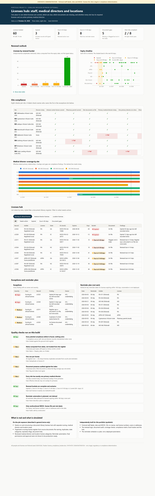
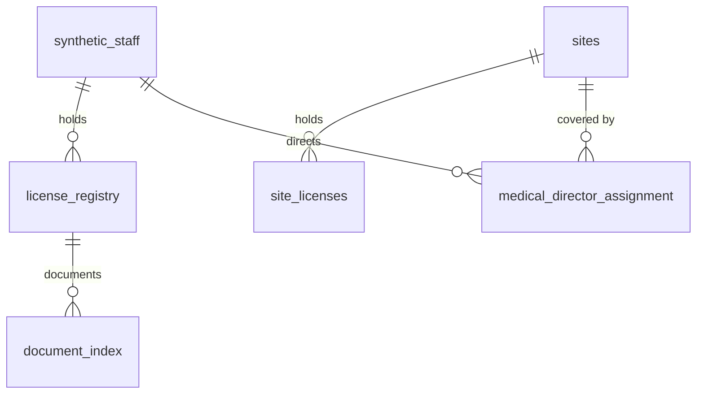

# Project D - Multi-state license compliance hub

> **SYNTHETIC DEMONSTRATION - not a legal, regulatory or compliance determination.**
> Staff appear only as role labels ("RN-007 (fictional)"). License IDs use a nonfunctional `MOCK-` pattern. No names, real
> license numbers, certificate images or addresses exist anywhere in this project.



**Interactive hub:** [live page](https://delmanuelcruz-wq.github.io/healthcare-analytics-portfolio/D_license_compliance_hub/dashboard.html) ([`dashboard.html`](dashboard.html) source) · **Tracker:** [`license_compliance_tracker.xlsx`](license_compliance_tracker.xlsx)

---

## 1. The business question

Can every site legally operate today, and what is about to lapse? That means knowing which **staff licenses** are current or
due, whether the **supporting document** is actually on file, whether each **site's own licenses** are valid, and whether every site
has exactly one active **primary medical director** whose own license is current.

## 2. Fictional business context

Coralline Infusion Network (fictional) has 44 clinical staff (RNs, LPNs, APRNs, pharmacists and four physician medical directors)
across eight sites in three states. It also holds 16 site licenses and permits. The register was assembled from documents, so it
contains the usual problems: a duplicate entry, statuses typed by hand, and document flags that do not match the document library.

## 3. What was real vs what I built here

| | |
|---|---|
| **On-the-job exposure (general terms only)** | Hands-on work on a document-library Licenses Hub with separate nursing, medical director and location areas. Organized a multi-state nursing license register from source documents: naming, duplicate handling, state categories, expiration flags and supporting document links. Reviewed medical director and location license data categories alongside it. |
| **Not shown to be production-ready on the job** | Reminder automation, final access permissions and approval. Nothing here claims a deployed reminder system or a business-wide rollout. |
| **Independently built for this portfolio** | Fictional staff, sites and licenses; renewal logic; document audit; director coverage checks; site compliance matrix; reminder *plan*; Excel tracker; this hub; QA and tests. |

## 4. Data used



| Table | Grain |
|---|---|
| `license_registry` | one row per license record (45 rows, 44 unique licenses) |
| `document_index` | one row per filed document (placeholders only) |
| `site_licenses` | one row per site license or permit |
| `medical_director_assignment` | one row per director x site relationship interval |

## 5. Definitions

| Item | Rule |
|---|---|
| Days to expiry | `expiry_date - as-of date`. Status is computed, never copied from the typed status |
| Renewal bucket | Expired (< 0), Due in 0-30, 31-60, 61-90 days, Current (90+). Each license sits in exactly one bucket |
| Document gap | `document_flag = 0`, **or** the flag says "on file" but the document index has nothing |
| Duplicate | Same license ID on two records. The duplicate is excluded from counts and reminders |
| Director coverage | One primary director per site at any time. No overlaps, no gaps |
| Site compliant | All eight checks pass: infusion license, pharmacy permit, site documents, director today, no overlap, director license, staff licenses, staff documents |

## 6. Data files

[`outputs/`](outputs/): `staff_license_register.csv`, `site_license_register.csv`, `director_coverage.csv`, `site_compliance_matrix.csv`,
`reminder_plan.csv`, `exceptions.csv`, `qa_results.csv`.

## 7. Repeatable code

| File | Purpose |
|---|---|
| [`sql/01_staff_licenses.sql`](sql/01_staff_licenses.sql) | Register with days to expiry, document count, duplicate detection |
| [`sql/02_site_licenses.sql`](sql/02_site_licenses.sql) | Site licenses with days to expiry |
| [`sql/03_director_coverage.sql`](sql/03_director_coverage.sql) | Effective-dated coverage plus the director's own license evidence |
| [`run.py`](run.py) | Findings, compliance matrix, reminder plan, Excel tracker, hub, QA |

```bash
python D_license_compliance_hub/run.py
python -m pytest D_license_compliance_hub/tests -q
```

## 8. Quality checks

- [`tests/test_project_d.py`](tests/test_project_d.py), 14 tests: bucket boundaries (8 parametrized edges); status computed from dates;
  every finding matches the ground-truth register; duplicates never receive reminders; reminders are labelled as a plan;
  the site matrix reflects each planted problem; the tracker keeps live formulas and conditional formatting.
- [`QA_LOG.md`](QA_LOG.md) - 8 checks (4 pass, 4 warn, 0 fail).

## 9. Deliverables

- **Hub:** tiles, renewal buckets (status colors with labels), expiry timeline, site compliance matrix, director coverage timeline, and
  tabbed list views (Nursing & clinical / Medical director / Location) with filters for *Needs action*, *Expired*, *Due in 90 days* and *Document gaps*.
  Exceptions with owners, and the reminder plan.
- **Excel tracker:** change one as-of cell and every license re-ages. `Days to expiry` and `Renewal bucket` are formulas, and buckets are
  color-coded with conditional formatting. Includes coverage (with a live `Current?` formula), the site matrix, the reminder plan, exceptions and QA.

## 10. What the synthetic data shows

- **Only 2 of 8 sites are fully compliant.** Every failure traces to a named finding and an owner.
- **Two licenses are expired but still typed "Active".** A register that trusts typed status would call them current.
- **Document flags lie.** Two records claim a document that does not exist, and two more are honestly marked missing.
- **One site has had no primary medical director since September 30**, and another had two overlapping primaries for 3.5 months.
- **Renewal workload:** 3 licenses are due within 30 days and 8 in 31-90 days. The plan holds 69 reminder dates over the next 180 days.

## 11. Limitations and next steps

- Real licensing rules differ by state and credential (compact privileges, CE requirements). Nothing here models a real board.
- Primary-source verification is represented by a date field only.
- Next: drive reminders from the plan table through a workflow tool. That would be a *new* build, not something claimed here.

---

### Resume-safe language

- *On the job:* "Organized a multi-state nursing license register and structured a document-library compliance hub with separate
  nursing, medical director and location areas."
- *Portfolio:* "Built a synthetic license compliance hub (SQL, Python, Excel) with computed renewal buckets, document-presence auditing,
  effective-dated medical-director coverage checks and a per-site compliance matrix."
