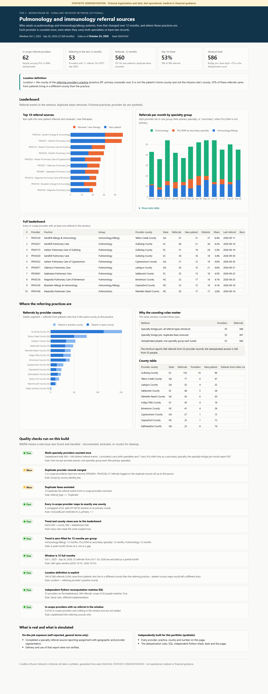

# Tier 2 #09 - Pulmonology / immunology referral-source analysis

> **SYNTHETIC DEMONSTRATION - not operational, medical or financial guidance.**
> Coralline Infusion Network, its providers and practices are fictional. Every number comes from generated data (seed `20261024`).
> This is an independent rebuild of a skill area, not an employer deliverable or result.



**Open:** [live page](https://delmanuelcruz-wq.github.io/healthcare-analytics-portfolio/tier2/09_specialty_referral_sources/dashboard.html) ([`dashboard.html`](dashboard.html) source) (leaderboard, 12-month trend, provider-county view, counting audit, QA)

## 1. The business question

Which providers send us pulmonology and immunology/allergy patients, how did that change over the last 12 months, and
where are those practices? Sales needs a ranked list it can trust: no provider listed twice, no inflated totals.

## 2. Fictional business context

Coralline Infusion Network (fictional) receives referrals from about 250 provider records. Some providers carry two
specialties, a few exist as two records, and some referrals arrive twice by fax. The window is the 12 full months from
**Oct 1, 2025 to Sep 30, 2026**. October 2026 is partial at the Oct 24 snapshot and is left out.

## 3. What was real vs what I built here

| | |
|---|---|
| **On-the-job exposure (self-reported, general terms)** | Completed a specialty referral-source reporting assignment involving geographic and provider segmentation. Delivery and use of the report were not verified. |
| **Independently built for this portfolio** | Fictional providers, the scope and deduplication rules, SQL, an independent Python check, the dashboard, QA and tests. |

## 4. Data used

| Table | Grain | Trap |
|---|---|---|
| `providers` | one row per provider **record** | duplicates share `source_identity_key` |
| `provider_specialties` | one row per provider x specialty | joining it multiplies a dual-specialty provider |
| `referrals` | one row per referral event | `referral_type = 'Duplicate'` is the same referral received twice |
| `postal_county_crosswalk` | one row per ZIP x county | ZIP 00150 sits in two counties; use `is_primary = 1` |
| `patients` | one row per patient | home county used only to show why the location definition matters |

## 5. Definitions

| Item | Rule |
|---|---|
| In scope | Provider **person** with Pulmonology or Immunology/Allergy on any record, primary or secondary |
| Specialty group | The person's primary specialty, or "PUL/IMM as secondary specialty". Exactly one group per person |
| Referral | Referral event in the window, duplicate faxes excluded |
| **Location** | **County of the referring provider's practice** (practice ZIP, primary crosswalk row) - not the patient's home county, not the infusion site |
| Leaderboard | Providers with 1+ referral in the window, ranked by referrals, then distinct patients |

## 6. Data files

[`outputs/`](outputs/): `leaderboard.csv`, `monthly_trend.csv`, `county_distribution.csv`, `double_count_audit.csv`,
`scope_providers.csv`, `qa_results.csv`.

## 7. How it works

| Step | File |
|---|---|
| Deduplicated people, scope, scoped referrals | [`sql/01_staging.sql`](sql/01_staging.sql) |
| Leaderboard | [`sql/02_leaderboard.sql`](sql/02_leaderboard.sql) |
| Zero-filled monthly trend | [`sql/03_monthly_trend.sql`](sql/03_monthly_trend.sql) |
| Provider-county distribution | [`sql/04_county_distribution.sql`](sql/04_county_distribution.sql) |
| Shortcut vs deduplicated totals | [`sql/05_double_count_audit.sql`](sql/05_double_count_audit.sql) |
| QA, independent Python check, dashboard | [`run.py`](run.py) |

```bash
python tier2/09_specialty_referral_sources/run.py
python -m pytest tier2/09_specialty_referral_sources/tests -q
```

## 8. Quality checks

[`QA_LOG.md`](QA_LOG.md): 10 checks (8 pass, 2 warn). [`tests/`](tests/) has 7 tests. They prove these points:

- Each person appears once.
- The dual-specialty provider is counted once.
- Duplicate records never rank as their own row.
- The leaderboard, trend and county totals are equal.
- A pure-Python version reproduces every provider's count.

## 9. The dashboard

Five tiles, the location definition in a call-out above the charts, a top-10 bar chart, the full leaderboard, a stacked
monthly trend by specialty group, a provider-county chart split by same-county vs other-county patients, the counting audit and QA.

## 10. What the synthetic data shows

- **62** provider people are in scope. **53** referred in the window, sending **560** referrals (337 for new patients).
- Concentration: the top 10 sources sent **53%** of referrals. One county (Gullwing, SC) holds 152 referrals from 10 providers.
- Pulmonology dominates (378 referrals) over Immunology/Allergy (135). The 7 providers who list PUL/IMM only as a
  secondary specialty still sent 47. Leaving them out would understate the market.
- Volume grew from 260 referrals (Oct-Mar) to 300 (Apr-Sep), +15%.
- **Counting rules move the total:** the specialty-bridge shortcut with faxes kept reports 586 (+5%) from 55 "providers".
  The deduplicated answer is 560 from 53 people.
- **Location matters:** 33% of referrals came from patients living in a different county than the referring practice.

## 11. Limitations and next steps

- Primary specialty decides the group. A provider who mostly treats asthma under a primary-care label sits in "secondary".
- Counties are fictional and no map is drawn. The county view is a ranked bar chart.
- Next steps: rolling-90-day active/dormant status for this scope (as in Project A) and a dormant-source outreach list.

---

*Resume-safe (on the job):* "Completed a specialty referral-source reporting assignment involving geographic and provider segmentation (self-reported)."
*Portfolio:* "Built a deduplicated referral-source leaderboard, 12-month trend and provider-county view with explicit location and double-counting rules, verified by an independent Python check."
