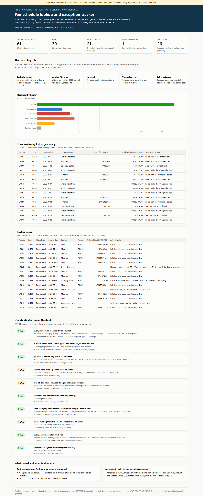

# Tier 2 #10 - Fee-schedule lookup and exception tracker

> **SYNTHETIC DEMONSTRATION - not reimbursement, billing, operational or financial guidance.**
> The codes are mock (XJ/XQ prefixes are not valid billing-code formats) and **every amount is invented**.
> Coralline Infusion Network is fictional (seed `20261024`). This is an independent rebuild of a skill area, not employer work product.



**Open:** [live page](https://delmanuelcruz-wq.github.io/healthcare-analytics-portfolio/tier2/10_fee_schedule_lookup/dashboard.html) ([`dashboard.html`](dashboard.html) source) · **Tracker:** [`fee_lookup_tracker.xlsx`](fee_lookup_tracker.xlsx) (Tracker, COUNTIF summary, shortcut errors, QA)

## 1. The business question

A revenue team sends a batch of medication billing codes and asks "what does the fee schedule pay for each?"
Every code needs exactly one answer. A code that pays **$0.00** must never be confused with a code that has **no rate at all**.

## 2. Fictional business context

The mock fee schedule has 90 rows for 70 codes, split by claim type (Professional / Facility). There are effective-dated
rate changes on Jan 1, 2026, a few rates that start on Apr 1, 2026, and six zero-pay codes. The request batch has 61
lookups. Some codes are absent from the schedule, some are requested under the wrong claim type, some have service dates
before any rate was in force, and one request was sent twice.

## 3. What was real vs what I built here

| | |
|---|---|
| **On-the-job exposure (self-reported, general terms)** | Completed a fee-schedule lookup for a batch of medication billing codes, tracking zero-dollar rates separately from missing ones. The final state of that tracker was not available for review. |
| **Independently built for this portfolio** | The mock catalog, schedule and requests, the matching rules, SQL, the Python cross-check, the Excel tracker, the dashboard, QA and tests. |

## 4. Data used

| Table | Grain | Key point |
|---|---|---|
| `code_catalog` | one row per mock code | 78 codes; 8 have no schedule row |
| `mock_fee_schedule` | one row per code x claim type x effective interval | `fictional_fee_amount = 0.00` means zero-pay |
| `lookup_requests` | one row per request | code, claim type requested, service date |

## 5. The matching rule

A **match** needs the same code, the same claim type, **and** a service date inside `[effective_from, effective_to]`
(blank `effective_to` = open-ended). Buckets are assigned in order, so each request lands in exactly one:

| # | Bucket | Rule |
|---|---|---|
| 1 | Duplicate request | Same code + claim type + service date as an earlier request (the original keeps its bucket) |
| 2 | Matched / **Zero-pay ($0.00)** | All three keys match; a $0.00 rate is an answer, not a miss |
| 3 | No match | Code not on the schedule at all |
| 4 | Wrong claim type | Code on the schedule, but only under another claim type |
| 5 | Out of date range | Code and claim type exist, but no interval covers the service date |

## 6. Data files

[`outputs/`](outputs/): `lookup_tracker.csv` (61 rows with bucket, matched row and next action), `bucket_summary.csv`,
`shortcut_errors.csv`, `qa_results.csv`. Every amount column name ends in `_synthetic`.

## 7. How it works

| Step | File |
|---|---|
| Ordered bucket rules, matched row, next action | [`sql/01_lookup_tracker.sql`](sql/01_lookup_tracker.sql) |
| The code-only VLOOKUP shortcut, for comparison | [`sql/02_naive_lookup.sql`](sql/02_naive_lookup.sql) |
| QA, Python cross-check, workbook, dashboard | [`run.py`](run.py) |

```bash
python tier2/10_fee_schedule_lookup/run.py
python -m pytest tier2/10_fee_schedule_lookup/tests -q
```

## 8. Quality checks

[`QA_LOG.md`](QA_LOG.md): 10 checks (7 pass, 3 warn). A warn here is an exception the tracker routed. [`tests/`](tests/) has 10 tests. They prove these points:

- Each request gets one bucket.
- Zero-pay rows carry a matched row and $0.00.
- Every match agrees on all three keys.
- A service date one day before a rate starts is out of range.
- A pure-Python classifier agrees on all 61 requests.
- Every workbook amount cell uses the `"SYN $"` number format.

## 9. The deliverables

- **Excel tracker:** one row per request with the bucket, matched fee row, synthetic amount and next action. A
  COUNTIF summary recomputes the bucket counts.
- **Dashboard:** the matching rule as five steps, the bucket chart, the shortcut-error table and the full tracker.

## 10. What the synthetic data shows

- **61 requests:** 33 matched, 6 zero-pay, 8 no match, 9 wrong claim type, 4 out of date range, 1 duplicate.
- **21 exceptions** need follow-up. Each carries a specific action, for example "code exists only as Facility - confirm the claim type".
- **A code-only VLOOKUP gets 26 of 61 wrong:**
  - It files all 6 zero-pay codes as not found.
  - It prices all 9 wrong-claim-type requests anyway.
  - It prices the 4 out-of-range requests.
  - It uses the 2025 rate for 6 requests dated in 2026.
  - It prices the duplicate request twice.
- Boundary case: LR052 has a service date of Mar 31, 2026, and its rate starts Apr 1, 2026. It is out of range by one day.

## 11. Limitations and next steps

- Requests are all Professional claims. A real batch would mix claim types and modifiers, which the same keys handle.
- The schedule has no units or billing multipliers. A next step would price units x rate per claim line.
- A real tracker would keep a status column for each exception (open / researched / resolved) with an owner and date.

---

*Resume-safe (on the job):* "Built a fee-schedule lookup and exception tracker for a batch of medication billing codes, separating zero-dollar rates from missing ones."
*Portfolio:* "Rebuilt the lookup on synthetic data with code + claim type + effective-date matching, six exclusive exception buckets and a Python cross-check, showing where a code-only VLOOKUP misprices 26 of 61 requests."
