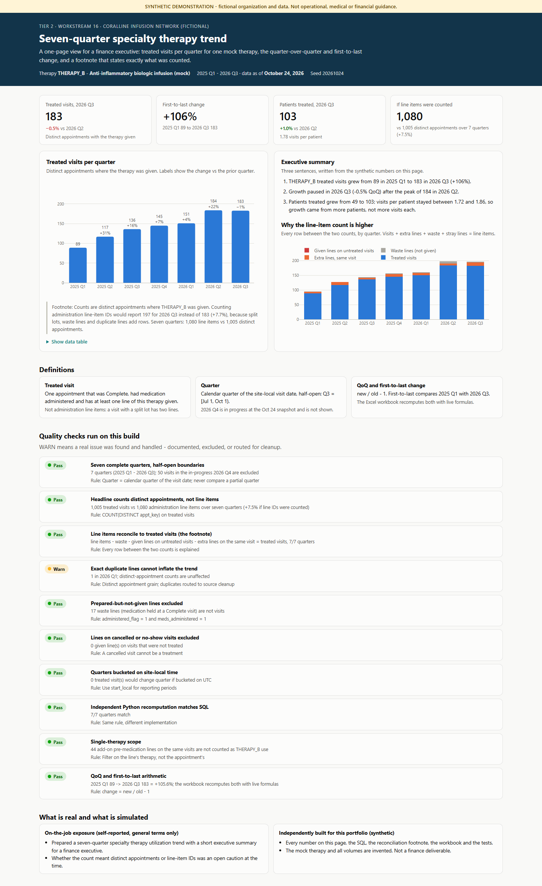
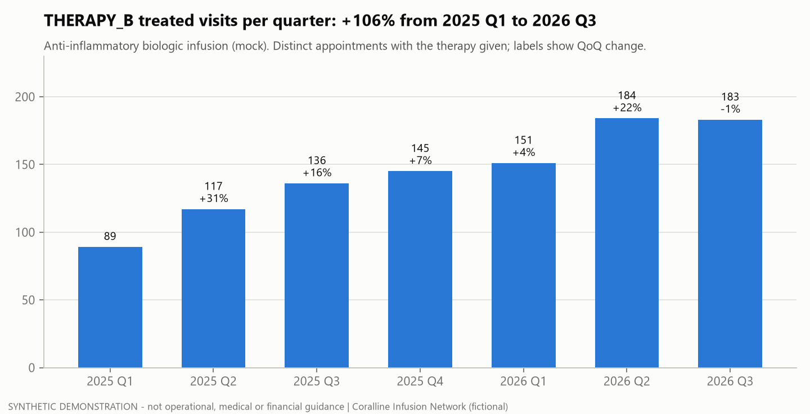

# Tier 2 #16 - CFO seven-quarter specialty therapy trend

> **SYNTHETIC DEMONSTRATION - not operational, medical or financial guidance.**
> Coralline Infusion Network is fictional. Every number comes from generated data (seed `20261024`).
> This is an independent rebuild of a skill area, not an employer deliverable or result.



**Open:** [live page](https://delmanuelcruz-wq.github.io/healthcare-analytics-portfolio/tier2/16_cfo_quarterly_trend/dashboard.html) ([`dashboard.html`](dashboard.html) source) · **Workbook:** [`cfo_seven_quarter_trend.xlsx`](cfo_seven_quarter_trend.xlsx) (one sheet, live formulas, native chart)

## 1. The business question

How has use of one specialty therapy changed over the last seven full quarters, and is growth still going?
The answer must be one chart, the quarter-over-quarter and first-to-last change, and a short summary.

## 2. Fictional business context

Coralline Infusion Network (fictional) gives a mock anti-inflammatory biologic infusion (`THERAPY_B`) at eight sites.
The window is 2025 Q1 to 2026 Q3. 2026 Q4 is still in progress at the Oct 24, 2026 snapshot, so it is left out.

## 3. What was real vs what I built here

| | |
|---|---|
| **On-the-job exposure (self-reported, general terms)** | Prepared and emailed a seven-quarter specialty therapy utilization trend with a concise executive summary for a finance executive. At the time it was not confirmed whether the count meant distinct appointments or line-item IDs. |
| **Independently built for this portfolio** | The SQL, the reconciliation footnote, the one-sheet workbook, the chart, the dashboard, the QA suite and the tests, all on synthetic data. |

## 4. Data used

| Table | Grain | Used for |
|---|---|---|
| `appointments` | one row per appointment | status, site-local visit date |
| `administrations` | one row per medication line (many per visit) | which therapy was given |
| `calendar` | one row per date | quarter of the visit date |

## 5. Metric definitions

| Metric | Rule |
|---|---|
| Treated visit | Distinct appointment: Complete, medication administered, and at least one `THERAPY_B` line given |
| Quarter | Calendar quarter of `start_local`, half-open (Q3 = [Jul 1, Oct 1)) |
| QoQ change | this quarter / prior quarter - 1 |
| First-to-last change | 2026 Q3 / 2025 Q1 - 1 |
| Line items (footnote only) | Every `THERAPY_B` administration row in the quarter, including split lots, waste lines and duplicates |

## 6. Data files

Output: [`outputs/seven_quarter_trend.csv`](outputs/seven_quarter_trend.csv) and `outputs/qa_results.csv`. Chart: [`charts/seven_quarter_trend.png`](charts/seven_quarter_trend.png).

## 7. How it works

| Step | File |
|---|---|
| Quarterly counts plus a line-item reconciliation | [`sql/01_quarterly_trend.sql`](sql/01_quarterly_trend.sql) |
| UTC vs local quarter shift; partial quarter | [`sql/02_boundary_checks.sql`](sql/02_boundary_checks.sql) |
| QA, workbook, chart, dashboard | [`run.py`](run.py) |

```bash
python tier2/16_cfo_quarterly_trend/run.py
python -m pytest tier2/16_cfo_quarterly_trend/tests -q
```

## 8. Quality checks

[`QA_LOG.md`](QA_LOG.md): 10 checks (9 pass, 1 warn). The 6 tests in [`tests/`](tests/) check these points:

- Line items reconcile to visits in every quarter.
- A separate Python version reproduces each quarter.
- The planted duplicate line adds no visit.
- The workbook values match the SQL, and the workbook uses live formulas.

## 9. The deliverables

- The workbook is one sheet for a finance reader: the table, QoQ formulas, first-to-last and compound growth, a three-line executive summary, and the counting-grain footnote.
- The dashboard shows the same chart with a stacked reconciliation of why line items exceed visits.



## 10. What the synthetic data shows

- Treated visits grew from **89** (2025 Q1) to **183** (2026 Q3), **+106%**. Growth paused in 2026 Q3 (-0.5% QoQ) after a peak of 184.
- Growth came from more patients (49 to 103), not more visits each: visits per patient stayed between 1.72 and 1.86.
- **Grain matters:** counting line-item IDs would report 1,080 instead of 1,005 visits (+7.5%). The gap comes from split lots, 17 waste lines and 1 exact duplicate line.

## 11. Limitations and next steps

- One therapy and one count. Revenue, payer mix and capacity are out of scope.
- Quarters with no closed updates can rise slightly as late visit updates arrive (see refresh case study #19).
- Next step: the same view for every therapy, with a consistent footnote template.

---

*Resume-safe (on the job):* "Prepared and delivered a seven-quarter specialty therapy utilization trend with a concise executive summary (self-reported)."
*Portfolio:* "Rebuilt the trend on synthetic data with an explicit distinct-appointment grain, a line-item reconciliation footnote and a formula-driven Excel one-pager."
