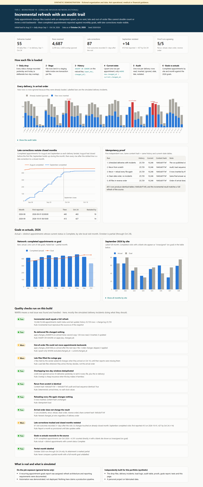

# Tier 2 #19 - Incremental refresh with an audit trail, and goals vs actuals

> **SYNTHETIC DEMONSTRATION - not operational, medical or financial guidance.**
> Coralline Infusion Network is fictional. Every number comes from generated data (seed `20261024`).
> This is a **personal project** on fabricated data. It does not describe a production pipeline at any employer.



**Open:** [live page](https://delmanuelcruz-wq.github.io/healthcare-analytics-portfolio/tier2/19_incremental_refresh/dashboard.html) ([`dashboard.html`](dashboard.html) source) (delivery chart, audit table, restatement, idempotency proof, goals vs actuals)

## 1. The business question

A recurring report compares completed appointments with monthly goals per site. The data arrives as daily change files.
How do you refresh it every day so that the numbers are right even when a file is re-sent, arrives late, or arrives out of order?
And how do you show readers that last month's number can still move?

## 2. Fictional business context

Coralline Infusion Network (fictional) has eight sites with 2026 monthly goals for completed appointments. The scheduling
system logs every status change: booked, confirmed, completed, cancelled, no-show. Visit outcomes are often recorded days
after the visit, so recent months keep changing after they close.

## 3. What was real vs what I built here

| | |
|---|---|
| **On-the-job exposure (general terms)** | A recurring appointment-goals report was assigned, and refresh architecture and reporting requirements were documented. Automation was **demonstrated, not deployed**. |
| **Independently built for this portfolio** | Everything here: drop files, simulated delivery incidents, load logic, audit table, proofs, goals report, dashboard, QA and tests. |

## 4. Data used

| Source | Grain | Role |
|---|---|---|
| `appointment_change_log` | one row per status change | the daily drop content |
| `appointments` | one row per appointment | site and visit time on each drop row; the full-refresh benchmark |
| `reporting_targets` | one row per site x month (2026) | goals |
| [`drops/`](drops/) | 54 CSV files, `appt_changes_YYYYMMDD.csv` | each holds every change recorded yesterday **and** today (a deliberate two-day overlap) |

## 5. Load rules

| Rule | Why |
|---|---|
| **History:** `INSERT OR IGNORE` on the natural key `(appt_key, changed_at)` | Re-sent files and overlapping windows cannot create duplicates |
| **Current state:** upsert one row per appointment, only `WHERE excluded.changed_at > current.changed_at` | A late or out-of-order file can never move a visit backwards |
| **One transaction per file, one audit row per delivery** | Every delivery is accounted for: read, inserted, ignored, stale, late, restated |
| **Deterministic arrival times** | Reruns are byte-for-byte reproducible |
| **Actual** = distinct appointments whose current status is Complete, by site-local visit month | Matches the goal definition; blank-site visits shown as "Unassigned" |

## 6. Data files

[`outputs/`](outputs/): `load_audit.csv`, `arrival_schedule.csv`, `goals_vs_actuals.csv`, `restatement.csv`,
`as_reported_trend.csv`, `idempotency_proof.csv`, `qa_results.csv`. Drops: [`drops/`](drops/) (regenerated byte-identical on every build).

## 7. How it works

| Step | File |
|---|---|
| Daily extract (two-day window) | [`sql/00_extract_drop.sql`](sql/00_extract_drop.sql) |
| Target tables: history, current state, audit, staging | [`sql/01_target_schema.sql`](sql/01_target_schema.sql) |
| Idempotent load of one file + audit measures | [`sql/02_load_stage.sql`](sql/02_load_stage.sql) |
| Goals vs actuals | [`sql/03_goals_vs_actuals.sql`](sql/03_goals_vs_actuals.sql) |
| Extract, delivery simulation, loads, proofs, dashboard | [`run.py`](run.py) |

Simulated delivery incidents (in [`arrival_schedule.csv`](outputs/arrival_schedule.csv)):

- The Sep 15 file is re-sent.
- The Oct 6 file arrives after the Oct 7 file.
- A sender outage holds the Oct 13 and Oct 14 files until Oct 16, after the Oct 15 file has loaded.

```bash
python tier2/19_incremental_refresh/run.py      # ~4 seconds, target database in memory
python -m pytest tier2/19_incremental_refresh/tests -q
```

## 8. Quality checks

[`QA_LOG.md`](QA_LOG.md): 11 checks (8 pass, 3 warn). The warnings are the simulated incidents and the late
corrections, each handled. [`tests/`](tests/) has 9 tests:

- The drop files regenerate byte-identical.
- The incremental load equals a full refresh.
- The re-delivery changes nothing, and the out-of-order file skips older changes.
- The audit arithmetic holds.
- Five proof runs agree.
- Goals vs actuals reconcile to the source.
- Late corrections only raise closed months.

## 9. The dashboard

- Five tiles and the six-step load flow.
- Every delivery in arrival order (new vs ignored rows, incidents labelled) with the full audit table.
- How August and September moved as each file landed, with the restatement table.
- The idempotency proof, network goals vs actuals, and September by site.

## 10. What the synthetic data shows

- **Incremental = full refresh:** after the initial load (23,470 changes to Aug 31) and 55 deliveries, all 10,246
  appointments match the source's status and last update, and history holds all 25,729 changes.
- **The overlap is cheap insurance:** 4,687 rows received, 2,259 new, 2,428 ignored.
- **Delivery incidents:**
  - The re-sent file inserted 0 rows.
  - The out-of-order file had 3 older changes, all skipped.
  - The two outage files added 60 changes when they finally arrived. Until then, reports were missing them.
- **Five runs, one answer:** the published run, a rerun from scratch, a rerun plus a reload of every file, clean date order,
  and reverse order all produce content hash `1645c8cf17ef`.
- **Closed months keep moving:** 87 visit outcomes were recorded 3+ days after the visit.
  - August was first reported as 445 completed appointments and is 463 by Oct 24 (+18).
  - September was first reported as 413 on Oct 1 and is 427 by Oct 24 (+14).
- **Goals:** the network beat its goal every month from January to August (100.5% to 113%). September stands at 427 of 455 (94%)
  and may still rise. By site in September, S06 reached 150% of goal and S07 55%. October is partial.
- 4 completed visits in 2026 have a blank site. They appear as "Unassigned" instead of disappearing.

## 11. Limitations and next steps

- Deletes are not modeled. The source never hard-deletes appointments; cancellations are status changes.
- Attributes are taken from the appointment as of the snapshot. A real feed would carry site changes in the file itself.
- Next steps:
  - A "provisional until day N" flag on recent months.
  - Alerts when an expected file is missing.
  - A scheduled job wrapper. Not built, because nothing here should be read as a deployed system.

---

*Resume-safe (on the job):* "Documented refresh architecture and reporting requirements for a recurring appointment-goals report; the automated pipeline is a separate personal project."
*Portfolio:* "Built an idempotent daily incremental load (natural-key upsert, audit table, late and out-of-order handling) that reproduces a full refresh exactly and reports goals vs actuals with visible restatements."
