# Grain guide - synthetic infusion network data model

> SYNTHETIC DEMONSTRATION - not operational, medical or financial guidance. Generated by `grain_guide.py` from `foundation/generator/schema.py`; do not edit by hand.

## 1. The referral-to-treatment path

| Step | Table | Grain | Rows |
|---|---|---|---:|
| 1 | `patients` | A person enters the network | 2,502 |
| 2 | `referrals` | Each referral event (renewals, duplicate faxes included) | 3,861 |
| 3 | `orders` | Each order series (renewals start a new one) | 3,516 |
| 4 | `authorizations` | Each prior-authorization request | 3,113 |
| 5 | `appointments` | Each chair appointment, any status | 10,246 |
| 6 | `administrations` | Each medication line at a visit | 9,424 |

Every step down this path can multiply rows. Count at the grain of the question, not the grain of the last join.

## 2. Fan-out traps (measured on the synthetic data)

| Trap | Base | Naive join rows | Grain-safe rows | Inflation | Rule |
|---|---:|---:|---:|---:|---|
| Counting patients after joining referrals | 2,502 patients | 3,861 | 2,502 | x1.54 | One patient has many referrals - count DISTINCT patient_key, or aggregate referrals first |
| Counting treated visits after joining administration lines | 8,642 treated visits | 9,294 | 8,642 | x1.08 | Split lots, add-on lines and duplicates give a visit several lines - use EXISTS, not JOIN |
| Provider specialty through the bridge table | 250 provider records | 270 | 250 | x1.08 | Some providers carry two specialties - filter is_primary = 1 (or use providers.primary_specialty) |
| ZIP to county through the crosswalk | 33 ZIP codes | 34 | 33 | x1.03 | ZIP 00150 straddles two counties - keep the primary-county row. No provider practices there today, so a provider join without the filter looks fine until one does (a latent bug) |
| Payer for a visit without the effective date | 8,642 treated visits | 15,163 | 8,638 | x1.75 | Coverage is effective-dated - join on the interval that covers the event date |
| Authorization outcome from the decision events | 3,113 authorization requests | 3,631 | 3,113 | x1.17 | Decision events include interim 'Pended' rows and duplicates - read the final outcome on the request |
| Counting new patients from order series | 2,324 patients with an order | 3,516 | 2,324 | x1.51 | Renewals and therapy changes create new order series for existing patients |

The effective-dated payer join returns 8,638 rows for 8,642 treated visits: 4 visits fall in a coverage gap (a planted defect for QA to find). An overlapping interval would double a visit instead. Neither is a reason to drop the date condition.

## 3. Entity-relationship diagram (from declared foreign keys)

```mermaid
erDiagram
    counties ||--o{ postal_county_crosswalk : "county_key"
    counties ||--o{ sites : "county_key"
    payer_plans ||--o{ payer_umbrella_map : "plan_key"
    payer_umbrellas ||--o{ payer_umbrella_map : "umbrella_key"
    specialties ||--o{ providers : "primary_specialty"
    providers ||--o{ provider_specialties : "provider_key"
    specialties ||--o{ provider_specialties : "specialty_code"
    counties ||--o{ patients : "home_region_code"
    sites ||--o{ patients : "primary_site_key"
    patients ||--o{ payer_history : "patient_key"
    payer_plans ||--o{ payer_history : "plan_key"
    patients ||--o{ referrals : "patient_key"
    providers ||--o{ referrals : "provider_key"
    patients ||--o{ orders : "patient_key"
    referrals ||--o{ orders : "referral_key"
    therapies ||--o{ orders : "therapy_key"
    sites ||--o{ orders : "site_key"
    orders ||--o{ order_status_events : "order_key"
    orders ||--o{ authorizations : "order_key"
    patients ||--o{ authorizations : "patient_key"
    payer_plans ||--o{ authorizations : "plan_key_at_request"
    authorizations ||--o{ authorization_decisions : "auth_key"
    patients ||--o{ appointments : "patient_key"
    orders ||--o{ appointments : "order_key"
    sites ||--o{ appointments : "site_key"
    therapies ||--o{ appointments : "therapy_key"
    appointments ||--o{ appointment_change_log : "appt_key"
    appointments ||--o{ administrations : "appt_key"
    therapies ||--o{ administrations : "therapy_key"
    sites ||--o{ inventory_transactions : "site_key"
    therapies ||--o{ inventory_transactions : "therapy_key"
    sites ||--o{ inventory_snapshots : "site_key"
    therapies ||--o{ inventory_snapshots : "therapy_key"
    sites ||--o{ purchase_orders : "site_key"
    therapies ||--o{ purchase_orders : "therapy_key"
    sites ||--o{ synthetic_staff : "home_site_key"
    synthetic_staff ||--o{ license_registry : "staff_key"
    license_registry ||--o{ document_index : "license_record_key"
    sites ||--o{ site_licenses : "site_key"
    sites ||--o{ medical_director_assignment : "site_key"
    synthetic_staff ||--o{ medical_director_assignment : "director_staff_key"
    therapies ||--o{ code_catalog : "therapy_key"
    code_catalog ||--o{ mock_fee_schedule : "mock_code"
    code_catalog ||--o{ lookup_requests : "mock_code"
    sites ||--o{ reporting_targets : "site_key"
    orders ||--o{ prescriptions : "order_key"
    patients ||--o{ prescriptions : "patient_key"
    therapies ||--o{ prescriptions : "therapy_key"
    prescriptions ||--o{ rx_fills : "rx_key"
    appointments ||--o{ rx_fills : "for_appt_key"
    sites ||--o{ delivery_tickets : "site_key"
    sites ||--o{ accounting_ledger : "site_key"
    therapies ||--o{ accounting_ledger : "therapy_key"
    inventory_transactions ||--o{ accounting_ledger : "source_event_key"
```

## 4. Every table: grain and key

| Table | Family | Grain | Primary key | Rows | Key unique |
|---|---|---|---|---:|:-:|
| `counties` | dimension | one row per fictional county | `county_key` | 14 | yes |
| `postal_county_crosswalk` | dimension | one row per ZIP x county allocation | `zip5, county_key` | 34 | yes |
| `sites` | dimension | one row per infusion site | `site_key` | 8 | yes |
| `specialties` | dimension | one row per specialty | `specialty_code` | 9 | yes |
| `therapies` | dimension | one row per mock therapy | `therapy_key` | 11 | yes |
| `payer_umbrellas` | dimension | one row per payer umbrella | `umbrella_key` | 11 | yes |
| `payer_plans` | dimension | one row per raw plan name as it appears in source | `plan_key` | 28 | yes |
| `payer_umbrella_map` | dimension | one row per mapped plan | `plan_key` | 26 | yes |
| `providers` | dimension | one row per provider record (not per real person) | `provider_key` | 250 | yes |
| `provider_specialties` | dimension | one row per provider x specialty | `provider_key, specialty_code` | 270 | yes |
| `patients` | journey | one row per synthetic patient | `patient_key` | 2,502 | yes |
| `payer_history` | journey | one row per patient coverage interval | `coverage_key` | 4,303 | yes |
| `referrals` | journey | one row per referral event | `referral_key` | 3,861 | yes |
| `orders` | journey | one row per medication order series | `order_key` | 3,516 | yes |
| `order_status_events` | journey | one row per order stage transition | `status_event_key` | 18,897 | yes |
| `authorizations` | journey | one row per prior-authorization request | `auth_key` | 3,113 | yes |
| `authorization_decisions` | journey | one row per decision event | `decision_key` | 3,631 | yes |
| `appointments` | journey | one row per appointment | `appt_key` | 10,246 | yes |
| `appointment_change_log` | journey | one row per appointment status change | `change_key` | 25,729 | yes |
| `administrations` | journey | one row per administration line item (many per appointment allowed) | `admin_key` | 9,424 | yes |
| `inventory_transactions` | operations | one row per inventory movement | `inventory_event_key` | 3,777 | yes |
| `inventory_snapshots` | operations | one row per site x therapy x week | `snapshot_key` | 2,715 | yes |
| `purchase_orders` | operations | one row per purchase order | `po_key` | 333 | yes |
| `synthetic_staff` | compliance | one row per fictional staff member | `staff_key` | 44 | yes |
| `license_registry` | compliance | one row per license record | `license_record_key` | 45 | yes |
| `document_index` | compliance | one row per filed license document | `document_key` | 40 | yes |
| `site_licenses` | compliance | one row per site license | `site_license_key` | 16 | yes |
| `medical_director_assignment` | compliance | one row per director x site relationship interval | `assignment_key` | 10 | yes |
| `code_catalog` | revenue | one row per mock billing code | `mock_code` | 78 | yes |
| `mock_fee_schedule` | revenue | one row per code x claim type x effective interval | `fee_row_key` | 90 | yes |
| `lookup_requests` | revenue | one row per code lookup request | `request_key` | 61 | yes |
| `reporting_targets` | operations | one row per site x month | `site_key, target_month` | 96 | yes |
| `submission_log` | operations | one row per generated manufacturer file | `batch_key` | 120 | yes |
| `prescriptions` | pharmacy | one row per prescription shipped by a specialty pharmacy | `rx_key` | 201 | yes |
| `rx_fills` | pharmacy | one row per prescription fill | `fill_key` | 452 | yes |
| `delivery_tickets` | pharmacy | one row per pharmacy delivery ticket | `ticket_key` | 446 | yes |
| `accounting_ledger` | accounting | one row per general-ledger inventory line | `gl_line_key` | 1,749 | yes |
| `exceptions_register` | qa | one row per injected defect or designed edge case | `exception_id` | 406 | yes |
