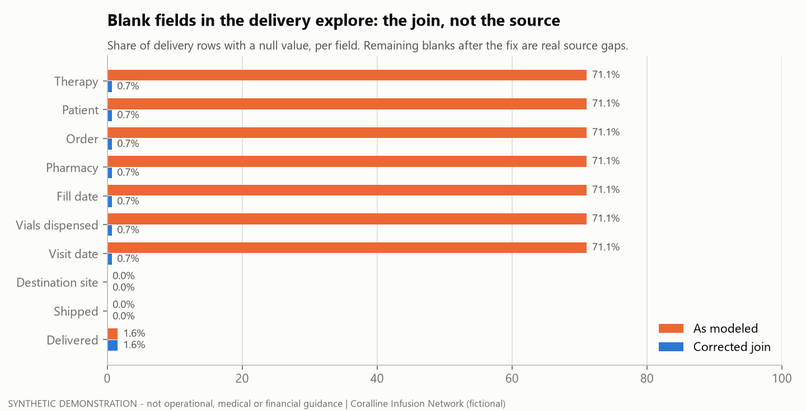
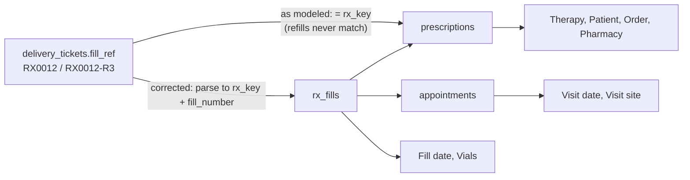

# Tier 3 #08 - BI field-lineage escalation: "why is Therapy blank?"

> **SYNTHETIC DEMONSTRATION - not operational, medical or financial guidance.**
> Fictional BI model, fictional specialty-pharmacy feed and generated data (seed `20261024`). Short micro-case, written as a postmortem.

**Read:** [`ISSUE_TICKET.md`](ISSUE_TICKET.md) - the escalation as it would be sent, with reproduction steps and evidence.

## Situation

Users of a delivery explore (specialty-pharmacy shipments to infusion sites) reported that **Therapy**, **Patient** and
**Visit date** were blank on most rows. The obvious guess was that the pharmacy feed had stopped sending them.

## What went wrong

Nothing was missing from the source. Every blank field reached the explore through **one join**:
`delivery_tickets.fill_ref = prescriptions.rx_key`. The pharmacy types an original fill as `RX0012` and refill *n* as
`RX0012-R3`. Refills never matched, so 317 of 446 rows (71%) lost every field behind that join.

## Investigation

1. **Field lineage:** traced each blank field back to its source column and the join it depends on. All of them shared the same join.
2. **Null-coverage audit:** measured the share of rows with a null value for each field in the explore as modeled ([`outputs/null_coverage.csv`](outputs/null_coverage.csv)).
   The rate was about the same in every full month (69-73%), so this was a modeling gap from day one, not a recent feed break.
3. **Rejected the quick fix:** `LIKE rx_key || '%'` plus a join on `rx_key` alone fills the blanks by attaching every fill to
   every ticket: 1,329 rows for 446 tickets (3.0x), with wrong visit dates ([`sql/02_quick_fix.sql`](sql/02_quick_fix.sql)).
4. **Corrected join:** parse the reference, then join the fill on `rx_key` + `fill_number`. That gives exactly one row per ticket ([`sql/03_corrected.sql`](sql/03_corrected.sql)).

## Fix and what was left

| | As modeled | Corrected |
|---|---:|---:|
| Rows / tickets | 446 / 446 | 446 / 446 |
| Therapy, patient, order, visit blank | 71.1% | 0.7% |
| Delivered time blank | 1.6% | 1.6% |

After the model fix, the remaining problems are **source** issues for the pharmacy-feed owner ([`outputs/source_issues.csv`](outputs/source_issues.csv)):

- 3 fill references that match no fill even after parsing (`RXO073-R1` with a letter O, and `RX0086-2R` with the suffix typed backwards).
- 4 tickets marked Delivered with no delivered time.
- 2 tickets shipped to a different site than the visit. This only became visible once the join worked.

Three more blank delivered times are **not** issues: those shipments were still in transit at the snapshot.

## Evidence

- `python tier3/08_field_lineage_escalation/run.py` rebuilds every output, the chart and the ticket.
- [`tests/test_t08_lineage.py`](tests/test_t08_lineage.py) has 6 tests:
  - The corrected join is 1:1, and the quick fix fans out.
  - The as-modeled blanks are exactly the non-bare references.
  - Every leftover issue is a defect planted in the ground-truth register (`DELIVERY_*`).
  - Every corrected row points at the right fill.

## Lessons

- A blank field is a question about lineage before it is a question about the source.
- Measure null coverage per field before and after a fix. Whatever survives the fix is the real data-quality list.
- Reject fixes that remove nulls by multiplying rows. Check row counts against the grain of the base table.
- Escalate with reproduction steps, the expected-vs-actual table, the root cause and a tested fix, and split model issues from source issues by owner.

## Real vs built

| | |
|---|---|
| **On-the-job exposure (general terms)** | Investigated field availability in a pharmacy-delivery explore and drafted a support request documenting the issue. |
| **Built here** | The synthetic pharmacy tables (generator v1.1.0), the three joins, the null-coverage audit, the ticket and the tests. The fix was never applied to any real model. |
