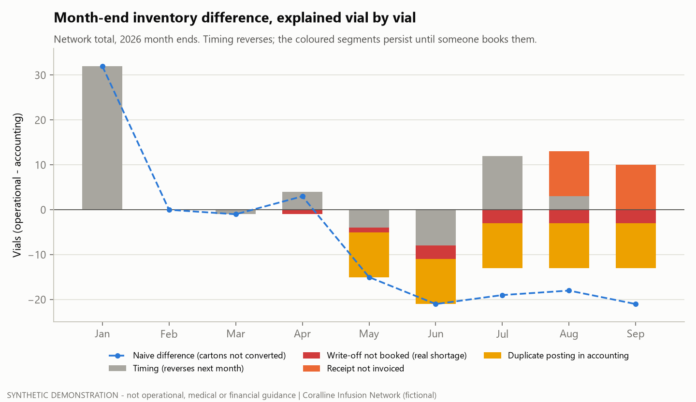

# Tier 3 #20 - Operational vs accounting inventory: timing or a real shortage?

> **SYNTHETIC DEMONSTRATION - not accounting, operational, medical or financial guidance.**
> Fictional organization, generated data (seed `20261024`), invented unit costs. **A learning case:** on the job this
> process was shadowed and reviewed, not performed. Short micro-case, written as a postmortem.

## Situation

Program drugs live in two systems:
- **Operational:** the inventory ledger the sites use, where every receipt, administration, waste, expiry and count adjustment moves vials.
- **Accounting:** the general ledger, where the same events post as invoices, cost of goods and write-offs, usually a day or more later.

At month end the two never agree exactly. The question is which differences are just **timing** and which are **real**.

## The trap

Two shortcuts give the wrong answer:

1. **Comparing the net total.** On Sep 30 the network is off by only **−3 vials**. That looks like noise, but 43 vials of difference sit across 8 site-drug cells.
   The −3 is a +10-vial receipt that was never invoiced, cancelled out by a −10-vial receipt posted twice, plus 3 vials of write-offs that never reached the books.
2. **Skipping unit conversion.** One receipt was recorded as 2 cartons instead of 20 vials. A comparison that ignores it invents
   an 18-vial shortage at one site from July onward.

## What I did

1. Confirmed both systems agree at the Dec 31, 2025 close in all 24 site x drug cells ([`sql/01_opening_positions.sql`](sql/01_opening_positions.sql)).
2. For each 2026 month end (Jan-Sep), computed both positions and walked the difference **event by event**, using each
   operational event's link to its postings ([`sql/02_events_and_postings.sql`](sql/02_events_and_postings.sql), [`run.py`](run.py)):

| Class | Rule | Behaviour |
|---|---|---|
| Timing | Event before month end, posting after | Reverses by the next month end |
| Write-off not booked (real shortage) | Expiry or count loss with no posting after the 14-day posting window | Persists - vials gone, books still carry them |
| Receipt not invoiced | Receipt with no posting after the window | Persists - books understate stock, and can go negative |
| Duplicate posting | One event posted twice | Persists - books overstate stock |

## What it found (synthetic)

- **Every vial explained:** 0 unexplained vials at every month end, in every cell.
- **Sep 30 timing (20 vials gross):** a 10-vial receipt on Sep 29 invoiced Oct 5, and Sep 30 administrations posted to cost of goods on Oct 1. All of it reverses.
- **Real items (23 vials gross; net only −3):**
  - 2 unbooked write-offs (−1 count loss at S02, −2 expired at S03) - the real shortage.
  - A 10-vial receipt at S03 never invoiced.
  - A 10-vial receipt at S04 posted twice.

  At invented unit costs that is SYN $52,650 of gross real differences, which net to only SYN −$4,650.
- **Negative book inventory needs a second look:**
  - S03 shows **−7 vials** in the books on Sep 30, and was also negative on Aug 31. Persistent negative stock is the signature of a missing receipt invoice.
  - S06 was −1 on Jan 31 only. That one was timing: 30 vials arrived on Jan 29, and the invoice posted Feb 5.

## Evidence

- `python tier3/20_inventory_accounting_recon/run.py` writes the outputs and the chart to [`outputs/`](outputs/):
  - `recon_month_end.csv` (cell level), `reconciling_items.csv` (event level), `recon_summary.csv`, `opening_positions.csv`.
- [`tests/test_t20_recon.py`](tests/test_t20_recon.py) has 7 tests:
  - Openings agree, and every vial is explained.
  - The planted ledger defects (`GL_*` in the ground-truth register) land in the right class.
  - Every timing item reverses by the next month end, and every real item persists.
  - The naive comparison breaks only on the carton receipt.
  - Persistent negative book stock maps exactly to the uninvoiced receipt.

## Lessons

- Reconcile **gross, by cell, by event**, never just the net total.
- Convert units before comparing. A unit mismatch looks exactly like a shortage.
- Timing has a signature: it reverses next month. Anything that survives two month ends is real and needs an owner.
- Negative book inventory is a symptom, not a diagnosis: one month can be an invoice in flight; two months means a missing receipt.

## Real vs built

| | |
|---|---|
| **On-the-job exposure (general terms)** | Shadowed and reviewed an inventory-to-financial-system reconciliation. Did not own or perform it. |
| **Built here** | The synthetic accounting ledger (generator v1.1.0), the event-level reconciliation, the classification rules, the chart and the tests - as a learning exercise. |
